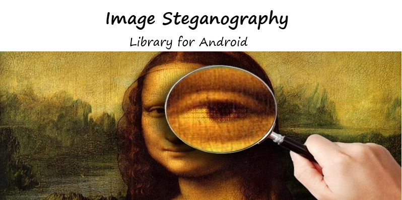
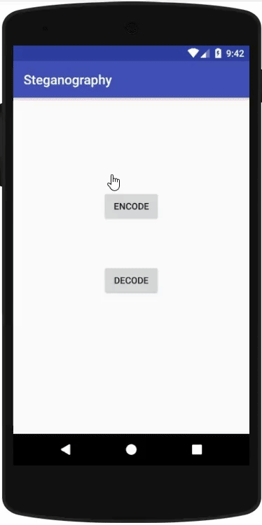
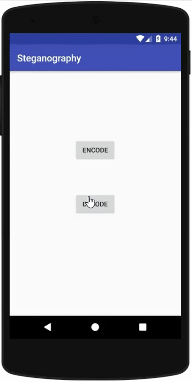

# 🖼️ Image Steganography for Android

  

  
  
  
  
  
  

Hide secret text inside images and decode it back with a secret key using an Android app and reusable library module.

---

## ✨ What this project includes

- ✅ Text **encoding** into image pixels (2-bit LSB approach)
- ✅ Text **decoding** from encoded images
- ✅ **AES-based encryption/decryption** with a secret key
- ✅ Android UI flows for selecting, encoding, saving, and decoding images
- ✅ Reusable steganography library module for integration

---

## 🧱 Tech stack

| Category | Technologies |
|---|---|
| Language | Java |
| Platform | Android SDK |
| Build System | Gradle (multi-module project) |
| UI | XML layouts, Android Support libraries |
| Architecture Style | Activity-based app + async background tasks (`AsyncTask`) |
| Core Algorithms | 2-bit LSB steganography, AES encryption |
| Testing | JUnit, Android Instrumentation tests (Espresso/Runner) |
| Distribution | JitPack-ready dependency integration |

---

## 📦 Project modules

- `app` → Main steganography Android application  
- `ImageSteganographyLibrary` → Core encode/decode + crypto library  
- `steganography` / `myapplication` → Additional Android modules and experiments

---

## 🎬 Preview

### Encode Flow

  

### Decode Flow

  

---

## 🚀 Getting started

1. Clone the repository
2. Open it in Android Studio
3. Sync Gradle files
4. Run the `app` module on emulator/device
5. Use **Encode** to hide text and **Decode** to retrieve it

---

## 🧠 How it works (high-level)

1. User picks an image and enters message + secret key  
2. Message is encrypted (AES)  
3. Encrypted payload is embedded in image pixels using 2-bit LSB encoding  
4. On decode, payload is extracted and decrypted with the provided key

---

## 📄 License

This project is licensed under the terms in the [LICENSE](LICENSE) file.
